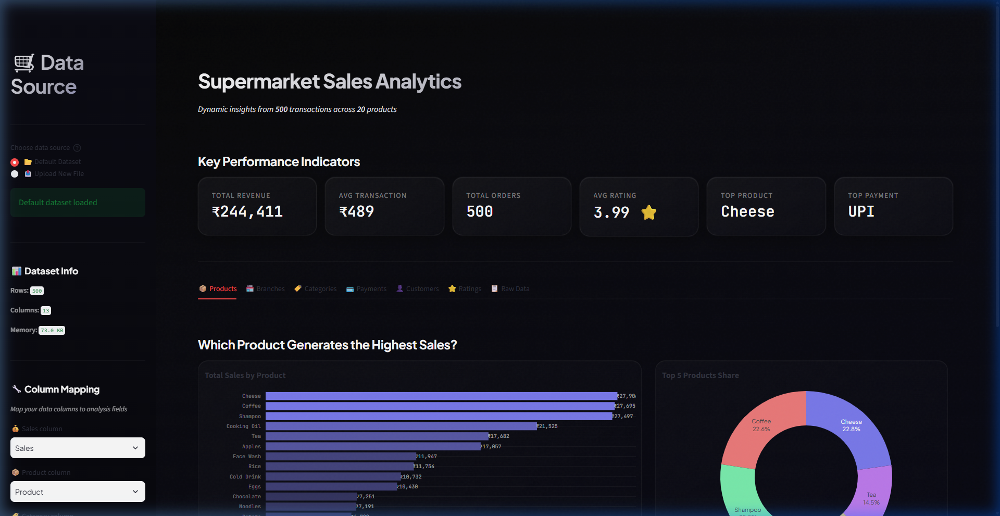
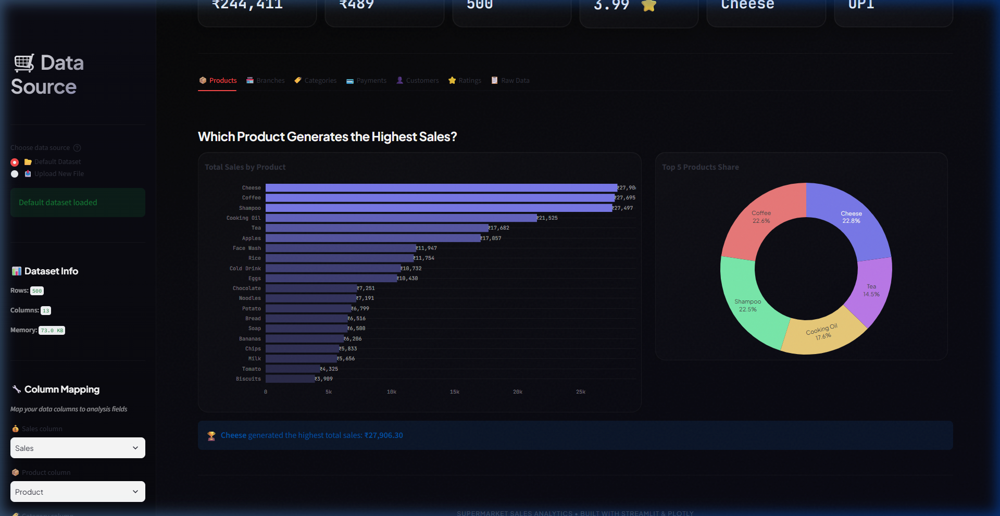

# 📖 User Manual: Supermarket Sales Analytics Dashboard

Welcome to the **Supermarket Sales Analytics Dashboard**. This dynamic application empowers you to upload sales data and instantly generate comprehensive, interactive business insights.

---

## 1. Interface Overview

When you launch the dashboard, you are greeted with a premium, dark-themed interface divided into two main sections:
1. **The Sidebar (Left)**: Controls for data ingestion, file uploading, and column mapping.
2. **The Main Panel (Right)**: The interactive visualization space containing your Key Performance Indicators (KPIs) and detailed analysis tabs.

*Figure 1: The main dashboard interface showing Key Performance Indicators (KPIs).*

---

## 2. Connecting Your Data

The dashboard is designed to be completely dynamic. While it loads a default dataset upon launch, you can easily connect your own data.

### Uploading a File
1. Look at the **"Data Source"** section in the left sidebar.
2. Select the **"Upload New File"** option.
3. Drag and drop your `.csv`, `.xlsx`, or `.ods` file into the upload zone.
4. The dashboard will automatically read your data and display a success message along with the dataset's memory usage and row count.

### Column Mapping
Because every dataset is different, the dashboard features **Smart Column Mapping**. 
- It attempts to auto-detect the correct columns for Sales, Products, Categories, Branches, etc.
- If it guesses incorrectly, or if you want to analyze a different metric, simply use the dropdown menus under **"Column Mapping"** in the sidebar to select the correct column from your uploaded file.

---

## 3. Navigating the Insights

Once your data is loaded, the main panel populates instantly. 

### Key Performance Indicators (KPIs)
At the very top, six KPI cards provide an immediate summary of your business:
- **Total Revenue**: The sum of all sales.
- **Avg Transaction**: The average value per order.
- **Total Orders**: The total number of rows/transactions in your dataset.
- **Avg Rating**: The mean customer satisfaction rating.
- **Top Product & Top Payment**: Quick highlights of your best performers.

### The Analysis Tabs
Below the KPIs, the data is sliced across 7 detailed tabs. Click any tab to switch views:

*Figure 2: Navigating through the interactive analysis tabs.*

- **📦 Products**: Ranks individual items by total sales volume and shows their market share.
- **🏪 Branches**: Compares performance across different store locations.
- **🏷️ Categories**: Groups products into high-level categories to find the most lucrative segments.
- **💳 Payments**: Analyzes customer payment preferences (e.g., Cash, Credit Card, E-wallet).
- **👤 Customers**: Breaks down spending habits between Member and Normal customer tiers.
- **⭐ Ratings**: Explores customer satisfaction distributions and compares ratings across branches and categories.
- **📋 Raw Data**: Provides a searchable, filterable table of your entire dataset alongside a correlation matrix for numeric fields.

---

## 4. Interacting with Charts

Every chart in the dashboard is fully interactive, powered by Plotly:
- **Hover**: Move your mouse over any bar, pie slice, or data point to see exact figures in a tooltip.
- **Zoom**: Click and drag a box over any chart area to zoom in on specific data.
- **Isolate Data**: Click items in the chart legends to toggle their visibility on and off.
- **Reset**: Double-click any zoomed chart to reset it to the default view.

---

## 5. Exporting Data

If you need to share the raw data with colleagues or use it in another tool, navigate to the **📋 Raw Data** tab. At the bottom of this tab, click the **"📥 Download as CSV"** button to export the currently loaded dataset directly to your computer.
